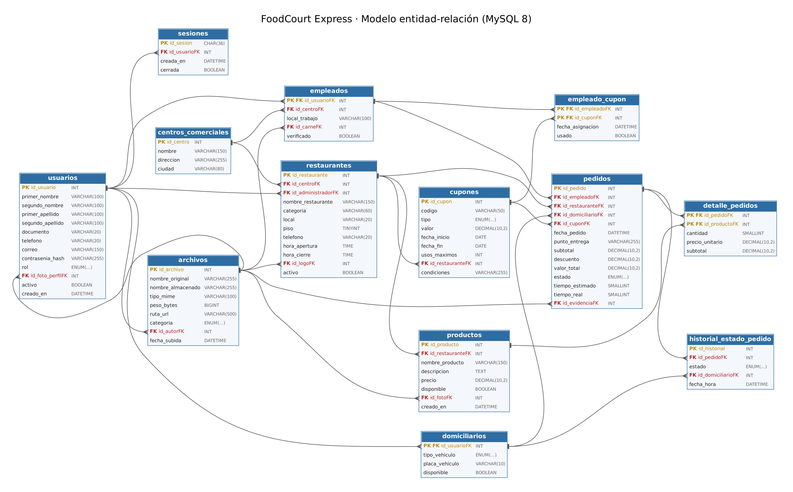

# 🚚 FoodCourt Express

Domicilios de los restaurantes del centro comercial para sus empleados.

## Problema

Quienes trabajan en un centro comercial tienen poco tiempo de almuerzo y no pueden dejar su local solo para ir a la plazoleta de comidas. Los restaurantes, por su lado, no tienen una forma ordenada de recibir esos pedidos internos ni de saber quién los entrega. Hoy todo se resuelve por WhatsApp o en persona, sin seguimiento.

## Objetivos

**General:** construir una aplicación web que permita a los empleados del centro comercial pedir comida a los restaurantes y recibirla en su local, con seguimiento del pedido de principio a fin.

**Específicos:**

- Manejar cuatro roles (empleado, restaurante, domiciliario y admin) con un solo inicio de sesión seguro (bcrypt + JWT).
- Llevar el pedido por sus estados (`pendiente → preparando → en_camino → entregado`) y guardar el historial de cada cambio.
- Garantizar las reglas de negocio en la base de datos con llaves foráneas, `CHECK` y triggers, y validarlas también en el backend.
- Guardar las imágenes (productos, logos, fotos de perfil, carnés y evidencias de entrega) con persistencia dual: archivo en disco y metadatos en MySQL.
- Ofrecer una interfaz sencilla y responsive que funcione desde el celular del empleado o del domiciliario.

## Arquitectura

```
┌──────────────────────┐   fetch + JWT    ┌───────────────────────────┐   PyMySQL   ┌──────────────┐
│  Frontend (APP/)     │ ───────────────▶ │  Backend FastAPI (:3000)  │ ──────────▶ │  MySQL 8     │
│  HTML + CSS + JS     │ ◀─────────────── │  rutas/ · seguridad.py    │ ◀────────── │  foodcourt   │
│  rutas con #hash     │      JSON        │  archivos.py              │             │  + triggers  │
└──────────────────────┘                  └─────────────┬─────────────┘             └──────────────┘
                                                        │ guarda archivos
                                                        ▼
                                              backend/uploads/<carpeta>/
```

- **Frontend:** una sola página (SPA) en JavaScript puro. Navega con rutas `#/…`, guarda el token en `sessionStorage` y protege las rutas privadas.
- **Backend:** API REST en FastAPI dividida por módulos (`auth`, `catalogo`, `pedidos`, `archivos`). También sirve el frontend y las imágenes públicas.
- **Base de datos:** MySQL 8 con 13 tablas. Los triggers cuidan las reglas del pedido y llenan el historial de estados.

### Modelo entidad-relación



`usuarios` es la tabla central: cada persona tiene un solo login, y los datos propios de su rol van en `empleados` o `domiciliarios` (relación 1 a 1). `pedidos` une al empleado, al restaurante, al domiciliario y al cupón; `detalle_pedidos` y `empleado_cupon` resuelven las relaciones N:M. Todas las imágenes viven en `archivos` y las demás tablas solo guardan su id.

### Persistencia dual

Cada imagen que se sube se guarda en dos partes, dentro de una sola operación:

1. **El archivo físico** va a `backend/uploads/<carpeta>/` con un nombre único (UUID), nunca con el nombre que manda el usuario.
2. **Sus metadatos** van a la tabla `archivos`: nombre original, nombre almacenado, tipo MIME, peso, ruta, categoría, autor y fecha.

| Categoría | Carpeta | ¿Pública? |
|---|---|---|
| `foto_producto` | `productos/` | Sí |
| `logo_restaurante` | `logos/` | Sí |
| `evidencia_entrega` | `entregas/` | Sí |
| `foto_perfil` | `perfiles/` | No, solo con login |
| `carne_empleado` | `carnes/` | No, solo con login |

Antes de guardar se valida la extensión, el tipo MIME, la firma real del archivo (magic bytes) y el peso máximo de 5 MB. Si falla la base de datos se borra el archivo del disco, y si falla el disco no se crea el registro, así nunca quedan enlaces rotos. Al eliminar un archivo se borra de los dos lados; la foto de entrega no se puede borrar porque es la prueba del pedido.

```
Proyecto-DEW/
├── APP/            Frontend (HTML + CSS + JS) que consume la API
├── backend/        API REST con Python + FastAPI + MySQL
│   ├── main.py         arranque, /health, errores y archivos estáticos
│   ├── db.py           conexión a MySQL
│   ├── seguridad.py    bcrypt, JWT y roles
│   ├── archivos.py     subida de fotos (persistencia dual)
│   ├── rutas/          auth.py · catalogo.py · pedidos.py
│   ├── uploads/        fotos subidas (se crea sola, no va al repo)
│   ├── requirements.txt
│   └── .env.example
├── database/       schema.sql · seed.sql · pruebas.sql
└── docs/           diagrama-er.png (modelo entidad-relación)
```

## Cómo correrlo

1. **Base de datos** (MySQL 8): en Workbench ejecuta `database/schema.sql` y luego `database/seed.sql`.
2. **Backend** (Python 3.10 o superior; en una terminal, dentro de la carpeta `backend`):
   ```bash
   python -m venv .venv
   .venv\Scripts\activate          # en Mac/Linux: source .venv/bin/activate
   pip install -r requirements.txt
   copy .env.example .env           # en Mac/Linux: cp .env.example .env
   python main.py
   ```
   Abre `.env` y pon tu contraseña de MySQL en `DB_PASSWORD`.
3. Revisa **http://localhost:3000/health**: debe decir `"base_de_datos": "conectada"`.
4. Abre **http://localhost:3000** para usar la app, o **http://localhost:3000/docs** para probar la API.
   Deja la terminal abierta mientras usas la app.

Al arrancar, el backend cambia los `HASH_PENDIENTE` del seed por hashes bcrypt reales.
Todos los usuarios de prueba quedan con la clave **1234**:

| Rol | Correo |
|---|---|
| Empleado | `ana@centro.com`, `julian@centro.com`, `valentina@centro.com`… (10 en total; `juanpablo@centro.com` está sin verificar) |
| Restaurante | `burger@foodcourt.co`, `pizza@foodcourt.co`, `criollo@foodcourt.co`, `sushi@foodcourt.co`, `postres@foodcourt.co`, `cafe@foodcourt.co` |
| Domiciliario | `andres@foodcourt.co`, `camila@foodcourt.co`, `jhon@foodcourt.co`, `paola@foodcourt.co`, `esteban@foodcourt.co`, `natalia@foodcourt.co` |
| Admin | `admin@foodcourt.co` |

Para probar el flujo completo abre 3 ventanas (una en incógnito): el empleado pide, el restaurante prepara, asigna domiciliario y despacha, y el domiciliario entrega con foto.

Cualquier empleado nuevo puede crear su cuenta desde **Regístrate** en la ventana de inicio de sesión.

## Endpoints

| Método | Ruta | Quién | Descripción |
|---|---|---|---|
| GET | `/health` | público | Prueba la conexión a MySQL |
| POST | `/api/login` | todos | `{correo, contrasenia}` → `{token, usuario}` |
| POST | `/api/registro` | público | Crea un empleado e inicia sesión |
| GET | `/api/centros` | público | Centros comerciales (para el registro) |
| GET | `/api/restaurantes` | público | Restaurantes activos |
| GET | `/api/productos?restaurante=id` | público | Productos con su foto |
| GET | `/api/cupones` | empleado | Cupones asignados sin usar |
| GET | `/api/cupones/validar?codigo=&restaurante=` | empleado | Valida un cupón |
| POST | `/api/pedidos` | empleado | `{items:[{id,cantidad}], punto_entrega, cupon?}` |
| GET | `/api/pedidos?activos=1` | todos | Pedidos según el rol |
| GET | `/api/pedidos/:id` | todos | Detalle, productos e historial de estados |
| PATCH | `/api/pedidos/:id/estado` | según rol | `{estado}` |
| GET | `/api/domiciliarios/disponibles` | restaurante | Domiciliarios libres |
| PATCH | `/api/pedidos/:id/domiciliario` | restaurante | `{id_domiciliario}` |
| POST | `/api/pedidos/:id/entregar` | domiciliario | `multipart`, campo `archivo` (foto opcional) |
| GET | `/api/mis-productos` | restaurante | Productos de su restaurante |
| PATCH | `/api/productos/:id` | restaurante | `{disponible?, precio?}` |
| POST | `/api/productos/:id/foto` | restaurante | `multipart`, campo `archivo` |
| POST | `/api/logout` | logueado | Cierra la sesión e invalida el token |
| POST | `/api/mis-productos` | restaurante | Crea un producto (201) |
| DELETE | `/api/productos/:id` | restaurante | Elimina un producto sin pedidos (409 si tiene pedidos) |
| POST | `/api/archivos` | logueado | `multipart`: `categoria` (`foto_perfil`, `carne_empleado`, `logo_restaurante`) + `archivo` |
| GET | `/api/archivos` | logueado | Archivos que subió el usuario (el admin ve todos) |
| GET | `/api/archivos/:id/descargar?ver=1` | dueño o admin | Ver (`ver=1`) o descargar el archivo |
| GET | `/api/perfil/foto` | logueado | Foto de perfil del usuario (404 si no tiene) |
| DELETE | `/api/archivos/:id` | dueño o admin | Borra el archivo del disco y de la tabla (las fotos de entrega no se borran) |

Los errores siempre responden `{"error": "...", "campos": {"campo": "mensaje"}}`; el frontend muestra cada mensaje debajo de su campo.
Las rutas protegidas usan `Authorization: Bearer <token>` (JWT, 8 h). El admin tiene todos los permisos.

## Prueba del flujo completo

Con el backend corriendo, abre tres ventanas (una en incógnito) y sigue esta lista:

1. **Landing:** abre `http://localhost:3000`, usa "Ver menú" y los botones "Iniciar sesión" / "Regístrate".
2. **Rutas privadas:** sin sesión, escribe `#/entregas` en la URL: debe llevarte al login y, después de entrar, volver a esa ruta.
3. **Empleado (ana@centro.com):** agrega productos, aplica un cupón, confirma el pedido y sigue su estado.
4. **Restaurante (burger@foodcourt.co):** "Empezar a preparar" → asigna un domiciliario → "Despachar".
5. **Domiciliario (andres@foodcourt.co):** sube una foto y marca "Entregado".
6. **Cierre:** el empleado ve el pedido en "Mis pedidos" con estado entregado; cada rol cierra sesión y las rutas privadas vuelven a pedir login.
7. **Recarga:** con F5 en cualquier vista la aplicación debe quedarse en la misma pantalla.


## Reglas de negocio

Las garantizan los triggers de `schema.sql`; el backend además las valida antes para dar mensajes claros:

- Un pedido = un solo restaurante, sin productos agotados.
- Solo empleados verificados pueden pedir.
- Cupón vigente, asignado al empleado, sin usar y válido en ese restaurante.
- Flujo: `pendiente → preparando → en_camino → entregado` (se puede cancelar antes de salir).
- No sale en camino sin domiciliario, y solo se asignan domiciliarios disponibles.
- Precios y descuentos se calculan con los datos de la BD, no con los del navegador.
- **Persistencia dual:** las fotos se guardan en `backend/uploads/` y sus metadatos en la tabla `archivos` (ver arriba).
